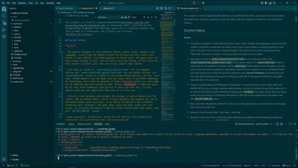
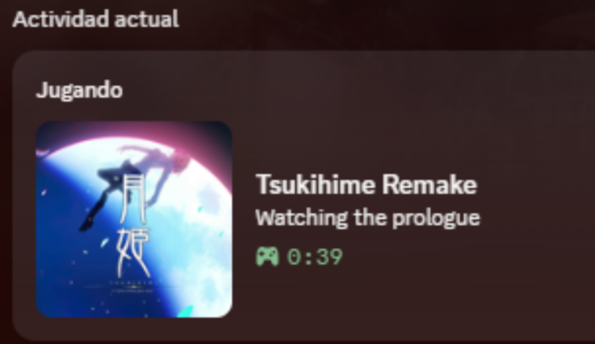
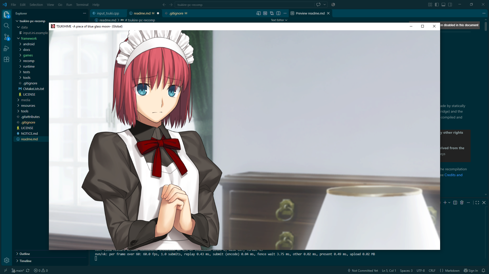
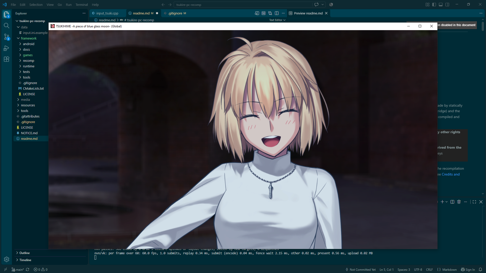
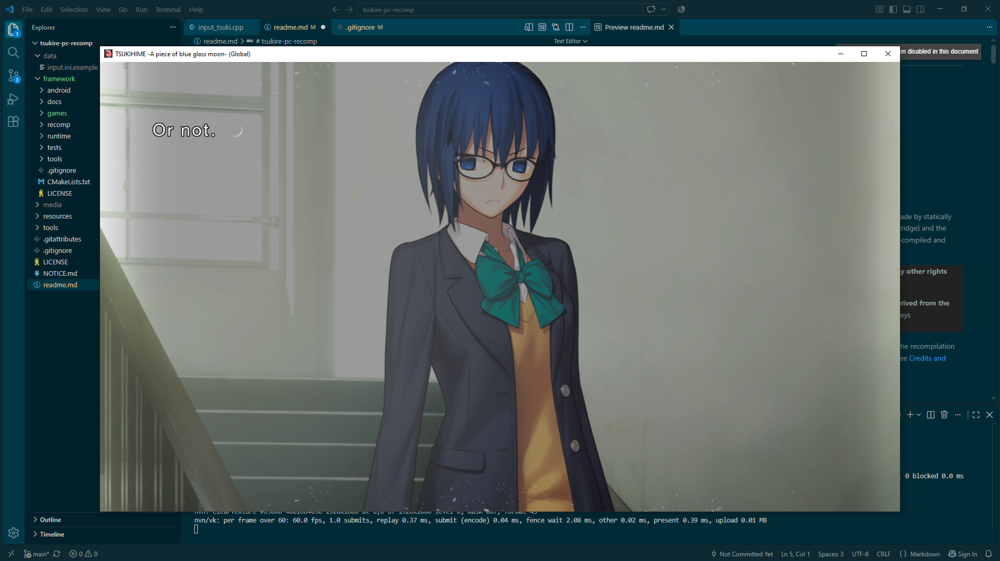
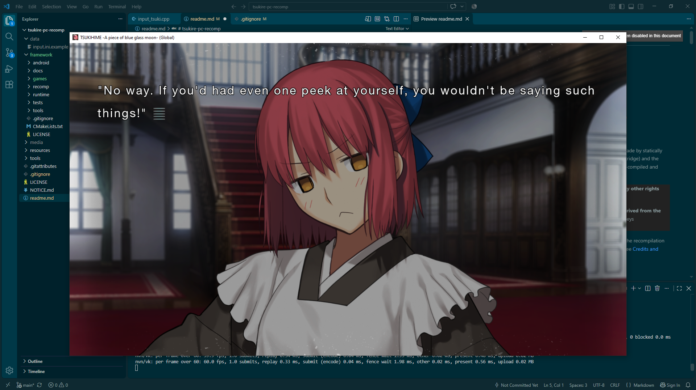
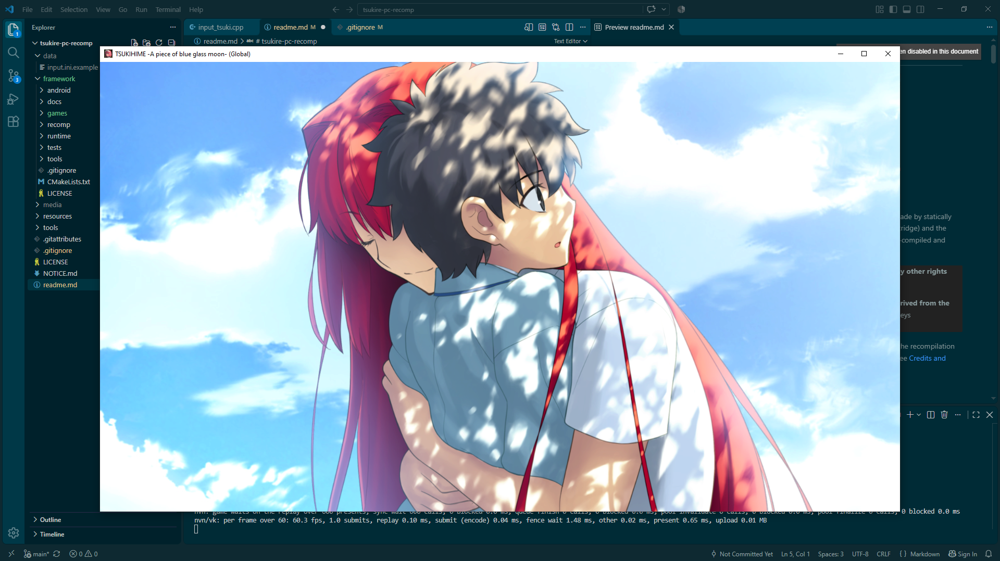
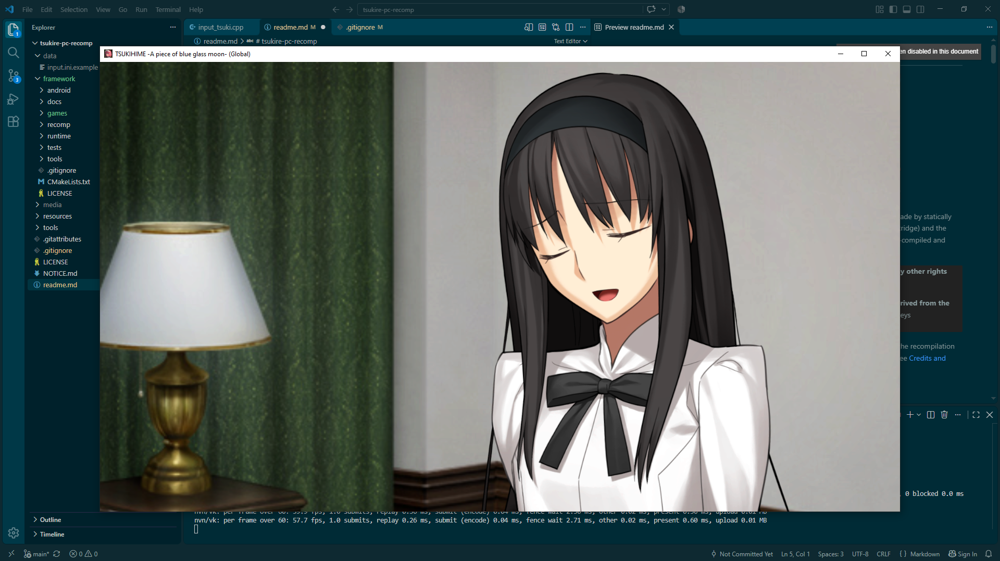

# tsukire-pc-port

> **This is a fan project. It is unofficial and has no affiliation with TYPE-MOON or any other rights holder of Tsukihime.**

<p align="center">
   
</p>

An unofficial PC port of *Tsukihime -A piece of blue glass moon-*, the remake of the original novel (I hope Red Garden/Far Side routes comes out soon), from Nintendo Switch, made by statically recompiling the game's own executable. It supports two editions, the Japanese one and the global one. On Windows you build the `.exe` yourself; on Linux the same `.exe` is cross-compiled and played with Proton (or Wine).


This repository contains **no game, no dumps, no keys, no firmware and no files derived from the game** (the only exceptions are the screenshots in `media/` and the executable's icon; see [Credits and licenses](#credits-and-licenses)). You must provide your own legally obtained copy of the game and your own keys (`prod.keys`). There are no instructions here for getting either.

**AI-assisted project.** This project was heavily AI-assisted using Claude (Anthropic). Most of the code was originally written in Spanish, my native language; the scripts needed to do a full port were later translated to English. See [How this was made](#how-this-was-made).

I own both copies of the game used for this port: a physical cartridge of the Japanese edition and a digital copy of the global edition. Both were dumped from my own Nintendo Switch with its own keys. No game files or ROMs were downloaded from the internet for this process.

This project is a fork of [SuperMarioWonderRecomp](https://github.com/BelmanteGu/SuperMarioWonderRecomp) by BelmanteGu (MIT), used here as the recompilation framework (the upstream repository is currently offline; the link is kept as a reference). See [Credits and licenses](#credits-and-licenses).

## Current status

**Works**

- The game is playable in both editions. Scenes from the middle of both the Arcueid and Ciel routes were tested in each edition, including playing the final scene. The games have not been played through in full, and not every scene was tested; of the "Teach Me, Ciel-sensei" sections, only some were tried.

- Automatic installation and build scripts for both Windows and Linux. You must provide your own game dump and keys: put them where the scripts look for them (`data/prod.keys` and the `.xci`/`.nsp` in the repository root) and the output is the `.exe`. See [Rebuild from scratch on Windows](#rebuild-from-scratch-on-windows) or [Rebuild on Linux and play with Proton](#rebuild-on-linux-and-play-with-proton) for more information.

- Community patches in .nsp format: drop them in updates\ and recompile. Only the changed files are extracted to mods\<edition>\, and the game is recompiled from the patch’s own executable when it has one. Tested with translation patches on the Japanese edition. See [Updates and patches](#updates-and-patches).

- Save data is stored in `<root>/data/tsuki/user/save` for the Japanese edition and `<root>/data/tsuki_global/user/save` for the global edition. The `data/<edition>` folder is created by the recompilation process, and the `user/save` folder appears once the game runs and saves. Back it up before updating or rebuilding. Saves from an emulator or from a Nintendo Switch save data dump can be imported and were tested to work.

- Tested on real hardware with Windows 10, Windows 11 and an Ubuntu Live ISO (Intel, AMD and NVIDIA GPUs), and on virtual machines with Windows 10 and an installed Ubuntu (both editions).

- Xbox controller. PlayStation, Switch Pro and Joy-Con (first generation) controllers also work through SDL3 and were tested OK.
- Mouse as touch screen (click = tap, drag = held tap).
- Keyboard and mouse with a Fate/stay night-style layout by default, and remapping of keyboard, controller and mouse with `input.ini`. A commented example is in `<root>/framework/games/tsukihime_common/input.ini.example`. **[See Controls section for more details](#Controls)**
- Fixed 16:9 picture with black bars; F11 / Alt+Enter fullscreen.
- Discord Rich Presence, tested on both editions on Windows. It has not been tested on Linux.
  <p align="left">
    
  </p>


**Known limitations**

- You need a GPU and driver with **Vulkan 1.3** (including `dynamicRendering` and `synchronization2`). An older driver (for example Vulkan 1.2) crashes; **update your GPU drivers**. Without a GPU, software rendering (`llvmpipe`) works on Linux but is slow; a Windows virtual machine without a GPU showed a blank screen with audio.
- Closing the window with the X button ends the process immediately, without waiting for the game to finish writing. Save from the in-game menu first. Once, a save started as a new game after such a close (cause not confirmed; it was restored from a copy), so a backup of your saves is cheap insurance.
- Discord Rich Presence shows the wrong route only if you jump into the middle of a day of the other route, so the route cannot be detected (Eventually with some extra coding, can be detected)
- The Linux build produces the same Windows `.exe`, which runs only under Proton or Wine. Plain Wine (without Proton) has broken audio: use Proton.

**Untested**

- Other Linux distros (the `dnf` and `pacman` paths exist in the scripts but were never run; Debian/Ubuntu is the tested path).
- Whether `-Compare` gives identical results between a Windows build and a Linux build.

**To do (also open for the community)**

- Native Linux build. Today the same Windows `.exe` is cross-compiled and runs under Proton or Wine.
- Android port. The framework still contains Android material from the fork, but nothing for Tsukihime has been done.
- Audio under plain Wine (without Proton).
- Test Fedora and Arch (the `dnf` and `pacman` paths exist but were never run).

## Screenshots

Some heroines and scenes. Hisui comes first by arbitrary choice.

<p align="center">
  
</p>

<table align="center" width="100%">
  <tr>
    <td width="50%"></td>
    <td width="50%"></td>
  </tr>
  <tr>
    <td width="50%"></td>
    <td width="50%"></td>
  </tr>
    <tr>
    <td colspan="2" align="center"></td>
  </tr>
</table>

## Rebuild from scratch on Windows

**Before you start, check [Requirements](#requirements) below.**

1. **Clone the repository.** The scripts do not clone it for you.

   ```powershell
   git clone https://github.com/Broomstick-Girl-Magical-Amber/tsukire-pc-port.git
   cd tsukire-pc-port
   ```

2. **Put your files in place.**
   - Create a `data` folder in the repository root and copy your `prod.keys` into it (`data\prod.keys`). The scripts only check that it exists and pass its path to `nstool`; they never read, copy or print it.
   - Copy your `.xci` / `.nsp` into the repository root. It does not matter which file is which edition: the script recognises the container by its header and the edition by the program ID. Or keep it elsewhere and use `-InputFile`.


3. **Install the requirements.** This takes about 30 to 60 minutes, and more on slower PCs (building `ffmpeg` is the longest part). The console may look stuck on a step; that is normal, so do not close it.
   > **Warning:** Windows Defender scans every file the `ffmpeg` build creates, which can make the build several times slower. Before running the script, you can exclude the vcpkg folder from scanning. Open a new PowerShell tab **as administrator** and run:
   >
   > ```powershell
   > Add-MpPreference -ExclusionPath 'C:\dev\vcpkg'
   > ```
   > If `Add-MpPreference` fails (for example with error `0x800106ba`), Windows Defender is not active on that PC, usually because another antivirus is installed. Skip this step: the installation works the same. That other antivirus may slow the build in the same way; if so, exclude `C:\dev\vcpkg` in that program.

   Then run the script (a normal, non-administrator console is fine; it asks for administrator permission once by itself):

    **Note: You must be in the root folder to run this script (tsukire-pc-port)**
      ```powershell
      powershell -ExecutionPolicy Bypass -File .\tools\install_requirements.ps1
      ```
    The console may stay quiet for long periods while ffmpeg builds. If it seems frozen, do not click inside the window: clicking pauses output in the Windows console. Press Esc or Enter and it continues.
 


4. **Recompile an edition.** `-Edition` is mandatory. **Close the console and open a new one first**: the installer puts the tools in the system `PATH`, but a console that was already open does not see them. This takes about 20 minutes or more on slower PCs.

    **Note: You must be in the root folder to run this script (tsukire-pc-port) and I recommend install/update your GPU drivers before launching the game**

   ```powershell
   powershell -ExecutionPolicy Bypass -File .\tools\recomp_tsukihime.ps1 -Edition global

   powershell -ExecutionPolicy Bypass -File .\tools\recomp_tsukihime.ps1 -Edition japan
   ```
   The final `.exe` is `<root>/framework/build/tsukihime/tsukihime.exe` (Japanese) or `<root>/framework/build/tsukihime_global/tsukihime_global.exe` (global).

   Community patches are also supported. See [Updates and patches](#updates-and-patches-experimental) for more details.


## Rebuild on Linux and play with Proton

The Linux scripts are thin wrappers that bring PowerShell 7 and run the same scripts as Windows, so the options are the same (`-Check`, `-From`, `-To`, `-Edition`, ...). Call them with `bash`.

```bash
# Install if you don't have it
sudo apt install curl tar coreutils

# Skip this if you already cloned the repo
git clone https://github.com/Broomstick-Girl-Magical-Amber/tsukire-pc-port.git && cd tsukire-pc-port

# Install the requirements. It takes about 20 minutes or more on slower PCs.
# It asks for sudo once (system packages) and asks you to accept the Microsoft license for the Windows CRT/SDK (xwin).

# Note: You must be in the root folder to run this script (tsukire-pc-port)
bash tools/linux/install_requirements_linux.sh

# Put your keys and your dump (.nsp or .xci) in place
mkdir -p data && cp /path/to/prod.keys data/prod.keys
cp /path/to/your-dump.xci .

# Recompile one edition: -Edition japan or -Edition global (about 20 minutes or more on slower PCs)

# Note: You must be in the root folder to run this script (tsukire-pc-port)
bash tools/linux/recomp_linux.sh -Edition japan
```

Community patches are also supported. See [Updates and patches](#updates-and-patches-experimental) for more details, but not tested in Linux.

Step 9 cross-compiles the **same Windows `.exe`** with `clang-cl` + `lld-link` against the Windows CRT/SDK fetched by `xwin`; it ends up in `framework/build/tsukihime/` or `framework/build/tsukihime_global/` exactly as on Windows. Long runs use `systemd-inhibit` when it works, so the machine does not suspend in the middle.

**Playing with Proton**

1. In Steam, choose Add a Non-Steam Game and select the `.exe` from `framework/build/tsukihime/` (Japanese) or `framework/build/tsukihime_global/` (global).
2. In the game's *Properties > Compatibility*, force **Proton Experimental**.
3. Launch it. No options are needed on real hardware (tested with the global edition). The data folder is resolved relative to the `.exe`, so nothing has to be moved.

Without a GPU (a VM with `llvmpipe`) set `NX_GPU_HANG_MS` in the launch options, for example `NX_GPU_HANG_MS=120000 %command%`. Without it the screen stays black for a few seconds and the game closes: the default watchdog gives the GPU 2 seconds.


### Some `install_requirements.ps1` options

| Option | Meaning |
|---|---|
| `-Check` | Only verify; install, download and create nothing. Exit code 1 if something is missing. |
| `-From N` / `-To N` | Run steps N to M (0 to 11). |
| `-Edition global\|japan\|both` | Which edition(s) to size the space check and summary for (default `both`). |
| `-Vcpkg <folder>` | vcpkg location (default `C:\dev\vcpkg`; `~/dev/vcpkg` on Linux). |

### Some `recomp_tsukihime.ps1` options

| Option | Meaning |
|---|---|
| `-Edition japan\|global` | **Required.** Edition to recompile. |
| `-From N` / `-To N` | Run steps N to M (0 to 10). |
| `-InputFile <path>` | Use this `.xci` / `.nsp` instead of looking in the repository root. |
| `-Keys <path>` | Keys file. It must be inside `data\` (default `data\prod.keys`). |
| `-Fonts <file or folder>` | Optional. The font is already in the repo (`resources\fonts`); use this only to supply another `shared_0.ttf`. |
| `-NoUpdates` | Build the base game only and do not read `updates\`. |

## Updates and patches

General support for official updates and community patches distributed as an installable `.nsp`. Tested so far only with translation patches for the Japanese edition. No updates or patches are distributed here.

1. Create an `updates` folder in the repository root and copy the `.nsp` into it, as downloaded. Both editions can share the folder: each recompilation takes only the ones for its edition. A name starting with `_` is ignored.
2. Run the recompilation again for that edition (`recomp_tsukihime.ps1 -Edition japan` or `global`, or `recomp_linux.sh` on Linux). **Important: if you recompiled before update support existed and deleted your dump, put it back for this first update recompilation. After that you can delete it again.**
3. Step 3 extracts only what the update changes. The changed game files go to `mods\<edition>\<name>\`. If the update brings its own executable, the game is recompiled from it. When it finishes, the `.nsp` can be deleted.

- For turning one off, rename its folder in `mods\<edition>\` to `_<name>` and recompile. Delete the folder to remove it.
- Loose mods (replacement files, no `.nsp`) can be copied to `mods\<edition>\<any name>\romfs\` without recompiling. Folders load in alphabetical order and the last one wins.
- Two active updates with different executables cannot be combined, and an update that changes a module other than the main executable is rejected.
- `-NoUpdates` builds the base game and ignores `updates\`.

## Requirements

You provide:

- A legal dump of the game, **base version v0 (1.0.0) only**, as `.xci` or `.nsp`, one per edition. The container format does not matter: either edition works in either format. An `.nsp` that bundles an update, or a dump that is already an updated version, is rejected as the base game (standalone updates and patches go in `updates\`, see [Updates and patches](#updates-and-patches)). (An `.xci` with an update partition is fine: only its base game is read.) Step 3 of `recomp_tsukihime.ps1` also refuses a binary other than the one the port was measured against.
- Your own `prod.keys`.
- On the working drive (`data\` + `build\`) you need about **22 GB for `japan edition`, 24 GB for `global edition` and 46 GB for both**. I recommend having 60 GB free. Keep the dumps on another drive if you can (use `-InputFile` to point to them). If they are on the same drive, add their size, because the scripts never delete them.


## Playing

- Windows: `framework\build\tsukihime_global\tsukihime_global.exe` (global) and `framework\build\tsukihime\tsukihime.exe` (Japanese). Double-click; there is nothing to install.
- Each edition has its own data folder (`data\tsuki_global` and `data\tsuki`), which holds that edition's saves in `user\save`. The `.exe` finds it relative to its own location (`..\..\..\data\<edition>`), so a full copy of the repository folder works anywhere. `NX_DATA_ROOT` overrides it.
- `F11` or `Alt+Enter` toggle fullscreen; `Ctrl+1`, `Ctrl+2`, `Ctrl+3` resize the window to 50 %, 75 % and 100 % of 1920 px.

### Controls

Defaults. The keyboard and mouse follow the layout of *Fate/stay night [Realta Nua]*. The controller layout follows the Nintendo one by **position**, so the right-hand button (B on an Xbox pad) advances the text.

| Action in game | Keyboard | Xbox controller |
|---|---|---|
| Advance text | Space, Enter or Down | B (right button) |
| Cancel / hide the text window (back in submenus) | Backspace | A (bottom) |
| Dialog menu (open / close) | Tab | Y (top) |
| System menu (Save, Load, Config, Flowchart, Title) | Esc, S, L or C | X (left) |
| Auto mode (toggle) | A | LB |
| Automatic fast-forward (toggle) | F | RB |
| Rewind while held | R | LT |
| Speed up while held | Ctrl | RT |
| Mini menu / move in menus | Up opens the mini menu; arrows move in menus | D-pad |
| Lists and flowchart, page by page | PageUp / PageDown | Left stick |

### Remapping with `input.ini`

The reference example is `framework/games/tsukihime_common/input.ini.example`: the same keyboard and mouse layout as the defaults above, commented in English, to use as a starting point. Copy it as `input.ini` next to the `.exe`, or into each edition's data folder (`data\tsuki` and `data\tsuki_global`), or point `NX_INPUT_INI` at any file. It has no `[mando]` section, so the controller keeps its default mapping.

The format is `<Npad button> = <key or button>, <another>` in `[teclado]`, `[mando]` and `[mouse]` sections. A section that is present replaces **all** the defaults of that device; delete it to get them back. Errors are written to the log with the line number and that entry is skipped.

### Environment variables

Set the variable in the same console before launching the game. The variable only lasts for that console. In `cmd`:

```bat
set NX_LANGUAGE=ja
tsukihime_global.exe
```

In PowerShell:

```powershell
$env:NX_LANGUAGE = 'ja'
.\tsukihime_global.exe
```

Under Proton, put the variable in the Steam launch options instead (for example `NX_LANGUAGE=ja %command%`).

| Variable | Effect |
|---|---|
| `NX_DATA_ROOT` | Data folder (default: relative to the `.exe`). |
| `NX_INPUT_INI` | Path of the `input.ini` to use. |
| `NX_LANGUAGE` | Text language, e.g. `en-US`, `ja`, `zh-Hans`, `zh-Hant`. Order of priority: this variable, then `language.txt` in the data folder, then the edition's default (`ja` for Japanese, `en-US` for global). |
| `NX_GPU_HANG_MS` | Raises the 2-second GPU watchdog (never below 2000). Only needed without a GPU. |
| `NX_GPU` | Chooses the GPU explicitly. |
| `NX_HANDHELD` | Handheld mode (1280x720). |
| `NX_DISPLAY_HZ` | **Experimental only.** Display refresh rate; the default is 60. Other values (for example 120) make the game run too fast. |
| `NX_SDL_PAD=0` | Use XInput instead of SDL3 for controllers. |
| `NX_MOUSE=0` | Turn the mouse-as-touch off. |
| `NX_DISCORD=0` | Turn Discord Rich Presence off. |
| `NX_INPUT_TRACE=1` | Log input, to debug a remap. |

The global edition contains English, Japanese, Simplified Chinese and Traditional Chinese text; the Japanese edition contains Japanese.

## How this was made

I want to be clear about how this project was built. Claude, Anthropic's AI assistant, wrote most of the new code: the scripts, the diagnostics and the patchers in `tools/patches/`. I did not write most of it myself.

My part was to define the goals and the rules (for example: a build that works from scratch on a clean machine), to test every change, to make the decisions, and to rewrite some of the code Claude generated. Claude was never installed on my PC and never edited the repository automatically: I shared the relevant scripts and ideas in a chat and applied every change by hand.

The recompilation framework itself is not mine and not Claude's: it comes from BelmanteGu's SuperMarioWonderRecomp.

## Credits and licenses

This repository is under the **MIT License** ([LICENSE](LICENSE)). [NOTICE.md](NOTICE.md) documents the third-party material that is included in the repository.

- **SuperMarioWonderRecomp** by BelmanteGu, MIT: the base of `framework/`. Its license and copyright notice are kept in `framework/LICENSE` and must stay with any copy of that code. Reference (currently offline): <https://github.com/BelmanteGu/SuperMarioWonderRecomp>. The Wonder-specific launcher art and icons were removed from the fork.
- **Ryujinx / Ryubing**: Ryujinx is a Nintendo Switch emulator, and Ryubing is the project the pinned source comes from. This port is not an emulator and does not use the emulator itself: only its shader translator is used, offline, to turn the game's Maxwell shaders into SPIR-V. It is not included in this repository: the install script downloads a pinned tarball from [Codeberg](https://codeberg.org/Software_arch/Ryubing), verifies it, and builds the translator locally with the patches in `framework/tools/maxwell/spirv_harness/translator/`. The harness describes it as MIT-licensed.
- **FFmpeg, libopus, SDL3, libjpeg-turbo, libpng and zlib**: installed through vcpkg, not included in this repository, and each one is under its own license. The built `.exe` is placed next to their DLLs.
- **Vulkan SDK** (LunarG): installed by the script for the headers and `spirv-val`, under its own license.
- **Noto Sans JP** (`resources/fonts`): SIL Open Font License 1.1, with `OFL.txt` next to the font.
- Build tools such as LLVM, CMake, Ninja, `nstool` and `xwin` are downloaded by the install scripts from their official sources and are not redistributed here.
- **Screenshots and intro animation** (`media/`): captures of the game, property of **TYPE-MOON / Aniplex** and the other rights holders. They are included only to show the port working. If you are a rights holder and want it removed, open an issue and the folder will be removed.
- ***Tsukihime -A piece of blue glass moon-*** and its artwork belong to **TYPE-MOON / Aniplex** and the other rights holders. The icon `framework/games/tsukihime_common/tsukihime.ico` derives from artwork of the game; it is included only to identify the executable. If you are a rights holder and want it removed, open an issue and it will be replaced.

## Legal notice and contributing

This is an independent, non-commercial fan project, provided as is, without warranty (see [LICENSE](LICENSE)). It is not affiliated with, endorsed by or sponsored by TYPE-MOON, Aniplex or any other rights holder. It contains no game data and no keys, and it does not help to obtain them. You are responsible for using only your own legally obtained copy of the game and your own keys, in accordance with the law where you live.

Issues and pull requests are welcome. Never attach or commit game data, dumps, keys, firmware or anything derived from the game (`gen`, `analysis`, extracted shaders, textures, audio or video) in an issue or a pull request. The root `.gitignore` is an allowlist for this reason: anything not named in it stays out of git.