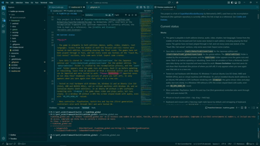
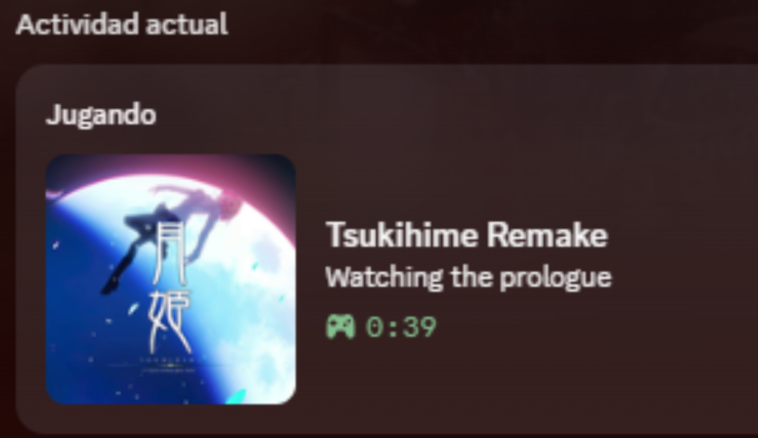
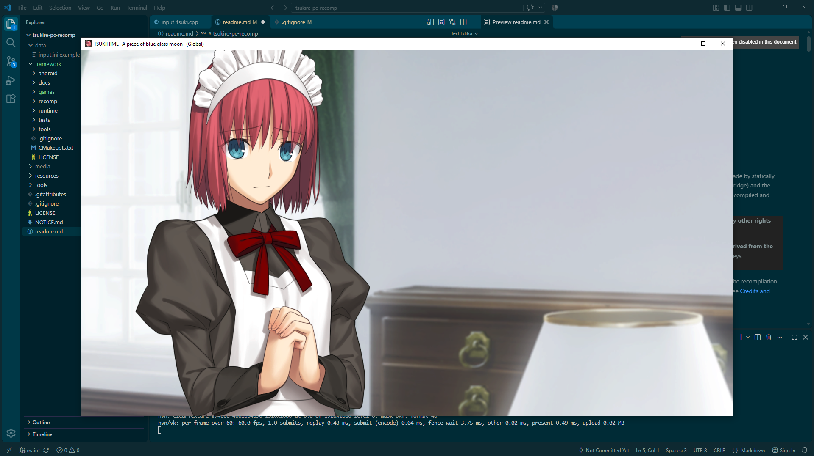
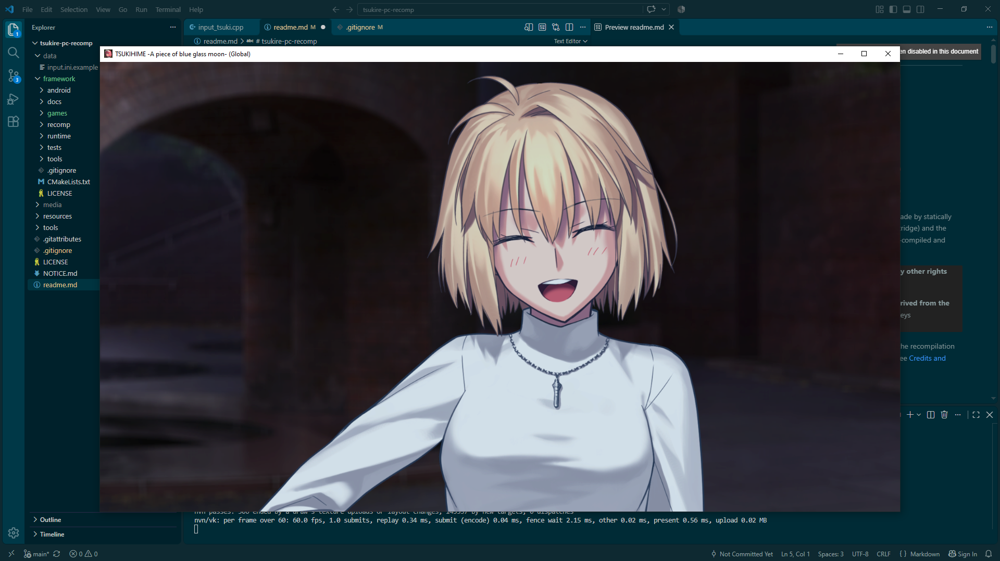
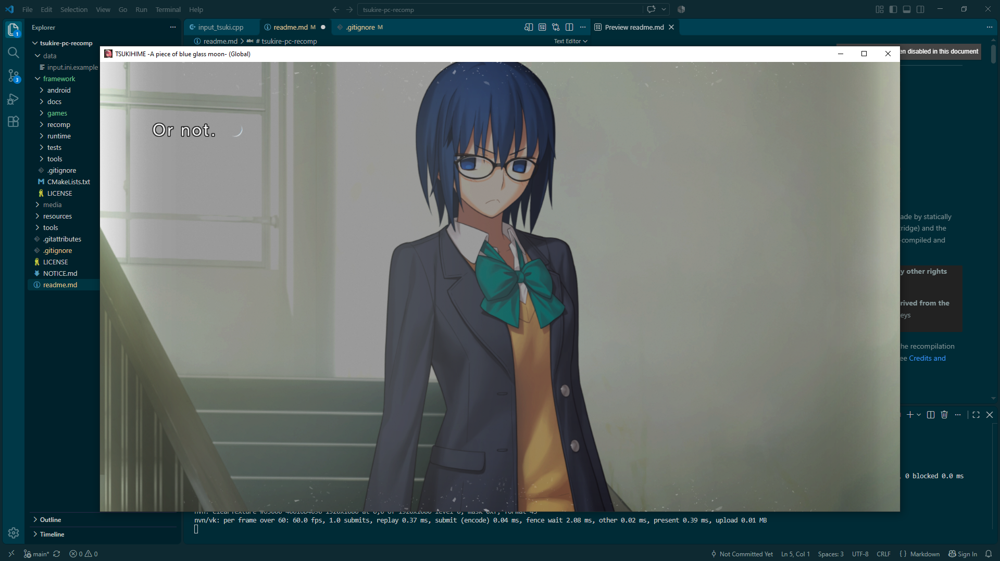
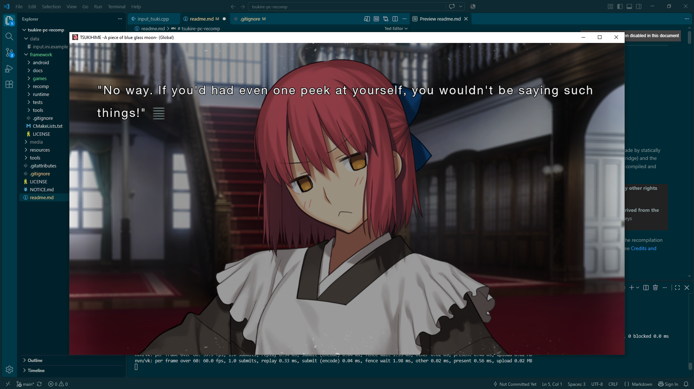
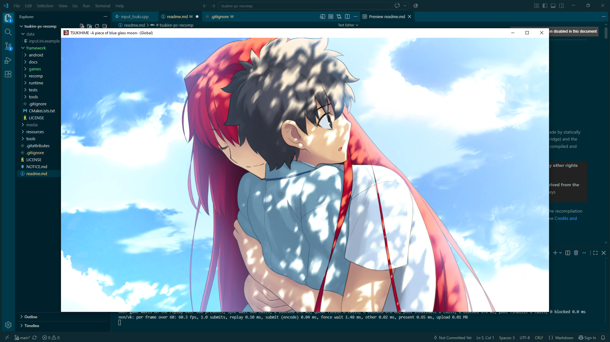
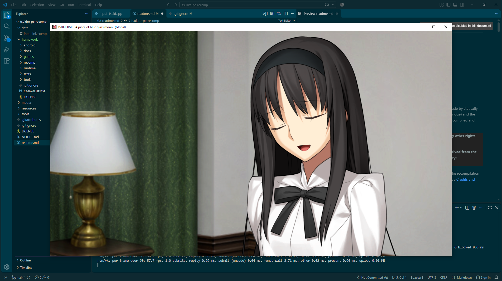

# tsukire-pc-port

> **This is a fan project. It is unofficial and has no affiliation with TYPE-MOON or any other rights holder of Tsukihime.**

<p align="center">
   
</p>

An unofficial PC port of *Tsukihime -A piece of blue glass moon-*, the remake of the original novel (I hope Red Garden/Far Side routes comes out soon), from Nintendo Switch, made by statically recompiling the game's own executable. It supports two editions, the Japanese one and the global one. On Windows you build the `.exe` yourself; on Linux the same `.exe` is cross-compiled and played with Proton.

This repository contains **no game, no dumps, no keys, no firmware and no files derived from the game** (the only exceptions are the screenshots in `media/` and the executable's icon; see [Credits and licenses](#credits-and-licenses)). You must provide your own legally obtained copy of the game and your own keys (`prod.keys`). There are no instructions here for getting either.

**AI-assisted project.** This project was heavily AI-assisted using Claude (Anthropic). See [How this was made](#how-this-was-made).

I own both copies of the game used for this port: a physical cartridge of the Japanese edition and a digital copy of the global edition. Both were dumped from my own Nintendo Switch with its own keys. No game files or ROMs were downloaded from the internet for this process.

This project is a fork of [SuperMarioWonderRecomp](https://github.com/BelmanteGu/SuperMarioWonderRecomp) by BelmanteGu (MIT), used here as the recompilation framework (the upstream repository is currently offline; the link is kept as a reference).

## Current status

**Works**

- Both editions are playable. Scenes from the middle of the Arcueid and Ciel routes were played in each edition, including the final scene, and both routes were fast-forwarded from the prologue to their endings with no errors. The game has not been played through in full. All of the "Teach Me, Ciel-sensei" sections were tried.
- One command installs everything and builds the game, on Windows (about **6 minutes**) and on Linux.
- **The port reads your dump directly.** The `.xci` / `.nsp` stays in the repository root and the game reads its files from it. Nothing is extracted.
- Community patches in `.nsp` format (tested with translation patches on the Japanese edition, on Windows and Linux). See [Updates and patches](#updates-and-patches).
- Saves are in `data/tsuki/user/save` (Japanese) and `data/tsuki_global/user/save` (global). Saves from an emulator or a Switch save dump can be imported. Back them up before updating or rebuilding.
- Tested on real hardware with Windows 10, Windows 11 and Ubuntu (Intel, AMD and NVIDIA GPUs), and on Windows 10 and Ubuntu virtual machines.
- Xbox, PlayStation, Switch Pro and Joy-Con (first generation) controllers (SDL3), plus keyboard and mouse with a *Fate/stay night*-style layout. Everything can be remapped with `input.ini`.
- The button icons follow the last device used (Xbox, PlayStation, Switch or keyboard).
- Fixed 16:9 picture with black bars; F11 / Alt+Enter fullscreen.
- A small easter egg: once you clear routes, you can pick which of the unlocked title screen backgrounds is shown, with F5/F6 or by clicking the logo (see `framework/games/tsukihime_common/title.ini.example`).

  **Keyboard Buttons**
    <p align="left">
      
    </p>

  **PlayStation Buttons**
    <p align="left">
      
    </p>

  **Xbox Buttons**
    <p align="left">
      
    </p>
- Discord Rich Presence (tested on Windows).


  <p align="left">
    
  </p>

**Known limitations**

- You need a GPU and driver with **Vulkan 1.3** (including `dynamicRendering` and `synchronization2`). An older driver crashes: **update your GPU drivers**. Without a GPU, software rendering (`llvmpipe`) works on Linux but is slow.
- Closing the window with the X button ends the process immediately. Save from the in-game menu first, and keep a backup of your saves.
- Discord Rich Presence shows the wrong route if you jump into the middle of a day of the other route.
- On Linux the build is the same Windows `.exe`, played with Proton. Plain Wine is not supported.

**To do (also open for the community)**

- Native Linux build.
- Android port (the framework still contains Android material from the fork; nothing for Tsukihime has been done).
- Test Fedora and Arch (the `dnf` and `pacman` paths exist in the scripts but were never run).

## Screenshots

Some heroines and scenes. Hisui comes first by arbitrary choice.

<p align="center">
  
</p>

<table align="center" width="100%">
  <tr>
    <td width="50%"></td>
    <td width="50%"></td>
  </tr>
  <tr>
    <td width="50%"></td>
    <td width="50%"></td>
  </tr>
    <tr>
    <td colspan="2" align="center"></td>
  </tr>
</table>

## Requirements

- A legal dump of the game, **base version v0 (1.0.0) only**, as `.xci` or `.nsp`, one per edition. Either edition works in either format. An `.nsp` that bundles an update, or an already updated dump, is rejected (updates and patches go in `updates\`). An `.xci` with an update partition is fine: only its base game is read.
- Your own `prod.keys`.
- Disk space: the dump itself (about 21–23 GB; it stays, because the game reads it) plus about **3 GB per edition** for `data\` and `build\`. On Windows the tools take about **5 GB more on `C:`** (`%LOCALAPPDATA%\tsuki-tools`).
- A GPU with Vulkan 1.3 to play.

## Dump and keys

- **For the dump**, put the `.xci` / `.nsp` in the repository root and **leave it there**: the game reads it every time it starts. The file name does not matter: the scripts recognise the container by its header and the edition by its program ID. If you move the repository folder (to another drive or PC), move the dump with it.
- **For the keys**, put `prod.keys` in `data\` (or in the root: the script moves it to `data\`). They are only needed while recompiling: the scripts never read, copy or print them, and the game never uses them.
- **Trimming the .XCI dump (optional):** a full cartridge dump has about 8.5 GB of empty padding. `-TrimXci` removes it from the `.xci` in place, after checking that it really is padding.
- **Extracting instead (optional):** `-Extract` extracts the whole RomFS to `data\<edition>\extract\romfs` (about 22–24 GB per edition), as older versions of the port did. The game then reads the extracted files and the dump is no longer needed.
- If the game cannot find its dump, it shows "Game data not found" and closes. `NX_ROMFS_DUMP=<file>` points it to a dump somewhere else.

## Rebuild on Windows

1. **Clone the repository.**

   ```powershell
   git clone https://github.com/Broomstick-Girl-Magical-Amber/tsukire-pc-port.git
   cd tsukire-pc-port
   ```

2. **Put your dump and keys in place** (see [Dump and keys](#dump-and-keys)).

3. **Install the requirements and recompile, in one command**, from the repository root. `-Edition` is `global`, `japan` or `both`. A normal, non-administrator console is fine.

   ```powershell
   powershell -ExecutionPolicy Bypass -File .\tools\install_requirements.ps1 -Recomp -Edition japan
   ```

   Right after the first checks, before installing anything, it asks you to accept the Microsoft license of the Windows CRT/SDK (or pass `-AcceptLicense` to accept it in the command); after that it runs on its own. It takes about **6 minutes** for one edition (depends on your PC). The console may look quiet on a step; do not close it. At the end it prints the time of every step. Add `-TrimXci` or `-Extract` if you want them.

   Everything goes to `%LOCALAPPDATA%\tsuki-tools`, for your user only, with no installers and no administrator.

The `.exe` is `framework\build\tsukihime\tsukihime.exe` (Japanese) or `framework\build\tsukihime_global\tsukihime_global.exe` (global).

**Later recompilations** (another edition, a patch, a new version of the repository) only need:

```powershell
powershell -ExecutionPolicy Bypass -File .\tools\recomp_tsukihime.ps1 -Edition japan
```

## Rebuild on Linux and play with Proton

The Linux scripts bring PowerShell 7 and run the same scripts as Windows, so the options are the same. Call them with `bash`, from the repository root.

```bash
sudo apt install curl tar coreutils git
git clone https://github.com/Broomstick-Girl-Magical-Amber/tsukire-pc-port.git && cd tsukire-pc-port

# Put your dump in the root and prod.keys in data/ first.
# Right after the first checks, before installing anything, it asks for sudo (system packages) and for the
# Microsoft license of the Windows CRT/SDK (xwin; -AcceptLicense accepts it in the command); then it runs on its own.
bash tools/linux/install_requirements_linux.sh -Recomp -Edition japan
```

Later recompilations: `bash tools/linux/recomp_linux.sh -Edition japan` (or `global`).

**Playing with Proton**

1. In Steam, choose *Add a Non-Steam Game* and select the `.exe` from `framework/build/tsukihime/` (Japanese) or `framework/build/tsukihime_global/` (global).
2. In the game's *Properties > Compatibility*, force **Proton Experimental**.
3. Launch it. The data folder and the dump are found relative to the `.exe`.

Without a GPU (a VM with `llvmpipe`), add `NX_GPU_HANG_MS=120000 %command%` to the launch options.

### Useful options

| Option | Script | Meaning |
|---|---|---|
| `-Recomp` | install | After installing, recompile the chosen edition(s). |
| `-Edition global\|japan\|both` | both | Edition(s) to recompile (`recomp_tsukihime.ps1` takes `japan` or `global`). |
| `-TrimXci` | both | Remove the padding of the `.xci`. |
| `-Extract` | both | Extract the whole RomFS instead of reading the dump. |
| `-InputFile <path>` / `-Keys <path>` | both | Another dump or keys file (keys must be inside `data\`). |
| `-NoUpdates` | recomp | Build the base game only and ignore `updates\`. |
| `-AcceptLicense` | install | Accept the Microsoft license of the Windows CRT/SDK in the command, without the question. |
| `-Check` | install | Only verify; install and create nothing. |
| `-From N` / `-To N` | both | Run only some steps. If a step fails, the script says from which step to resume. |

## Updates and patches

Official updates and community patches distributed as an installable `.nsp`. No updates or patches are distributed here.

1. Create an `updates` folder in the repository root and copy the `.nsp` into it. Both editions can share the folder. A name starting with `_` is ignored.
2. Recompile that edition (`recomp_tsukihime.ps1 -Edition japan` or `global`, or `recomp_linux.sh` on Linux).
3. Only the files the patch changes are extracted, to `mods\<edition>\<name>\`. If the patch brings its own executable, the game is recompiled from it. Afterwards the `.nsp` can be deleted (the dump cannot).

- To turn one off, rename its folder in `mods\<edition>\` to `_<name>` and recompile. Delete the folder to remove it.
- Loose mods (replacement files) can be copied to `mods\<edition>\<any name>\romfs\` without recompiling. Folders load in alphabetical order and the last one wins.
- Two active updates with different executables cannot be combined.

## Playing

- Double-click the `.exe`; there is nothing to install. Each edition has its own data folder (`data\tsuki`, `data\tsuki_global`), found relative to the `.exe`, so the whole repository folder (with the dump) can be copied anywhere, even to another PC.
- `F11` or `Alt+Enter` toggle fullscreen; `Ctrl+1`, `Ctrl+2`, `Ctrl+3` resize the window to 50 %, 75 % and 100 % of 1920 px.

### Controls

The keyboard and mouse follow the layout of *Fate/stay night*. The controller follows the Nintendo layout by **position**, so the right-hand button (B on Xbox, circle on PlayStation) advances the text.

| Action in game | Keyboard | Xbox controller |
|---|---|---|
| Advance text | Space, Enter or Down | B (right button) |
| Cancel / hide the text window (back in submenus) | Backspace | A (bottom) |
| Dialog menu (open / close) | Tab | Y (top) |
| System menu (Save, Load, Config, Flowchart, Title) | Esc, S, L or C | X (left) |
| Auto mode (toggle) | A | LB |
| Automatic fast-forward (toggle) | F | RB |
| Rewind while held | R | LT |
| Speed up while held | Ctrl | RT |
| Mini menu / move in menus | Up opens the mini menu; arrows move in menus | D-pad |
| Lists and flowchart, page by page | PageUp / PageDown | Left stick |

**Remapping:** copy `framework/games/tsukihime_common/input.ini.example` as `input.ini` next to the `.exe` or into the edition's data folder (or point `NX_INPUT_INI` at it). Sections are `[teclado]`, `[mando]` and `[mouse]`, with lines like `<Npad button> = <key or button>, <another>`. A section that is present replaces all the defaults of that device. Errors go to the log with their line number.

### Environment variables

Set them in the console before launching the game (`set NX_LANGUAGE=ja` in `cmd`, `$env:NX_LANGUAGE = 'ja'` in PowerShell), or in the Steam launch options under Proton (`NX_LANGUAGE=ja %command%`).

| Variable | Effect |
|---|---|
| `NX_LANGUAGE` | Text language: `en-US`, `ja`, `zh-Hans`, `zh-Hant` (global edition). Also read from `language.txt` in the data folder. |
| `NX_DATA_ROOT` | Data folder (default: relative to the `.exe`). |
| `NX_ROMFS_DUMP` | Dump to read when it is not in the repository root. |
| `NX_INPUT_INI` | Path of the `input.ini` to use. |
| `NX_GPU` | Chooses the GPU explicitly. |
| `NX_GPU_HANG_MS` | Raises the 2-second GPU watchdog. Only needed without a GPU. |
| `NX_HANDHELD` | Handheld mode (1280x720). |
| `NX_HUD_GLYPHS` | Button icons: `auto` (default), `xbox`, `ps`, `switch`, `keyboard` or `off`. |
| `NX_SDL_PAD=0` / `NX_MOUSE=0` / `NX_DISCORD=0` | XInput instead of SDL3 / no mouse-as-touch / no Discord. |

## How this was made

Claude, Anthropic's AI assistant, wrote most of the new code. It was the scripts, the diagnostics and the patchers in `tools/patches/`. Most of it was first written in Spanish, my native language, and later translated to English.

My part was to define the goals and the rules (for example: a build that works from scratch on a clean machine), to test every change, to make the decisions, and to rewrite some of the generated code. Claude was never installed on my PC and never edited the repository automatically: I shared the relevant scripts and ideas in a chat and applied every change by hand.

The recompilation framework itself comes from BelmanteGu's SuperMarioWonderRecomp.

## Credits and licenses

This repository is under the **MIT License** ([LICENSE](LICENSE)). [NOTICE.md](NOTICE.md) documents the third-party material included in the repository.

- **SuperMarioWonderRecomp** by BelmanteGu, MIT: the base of `framework/`. Its license is kept in `framework/LICENSE` and must stay with any copy of that code. The Wonder-specific launcher art and icons were removed.
- **Ryujinx / Ryubing**: only its shader translator is used, offline, to turn the game's Maxwell shaders into SPIR-V (the emulator itself is not used). Not included in this repository: on Windows it comes prebuilt (`spirv_harness`) in this repository's releases, built from the pinned source with the patches in `framework/tools/maxwell/spirv_harness/translator/`; otherwise the install script downloads the pinned source from [Codeberg](https://codeberg.org/Software_arch/Ryubing), verifies it and builds it. MIT-licensed.
- **libopus, SDL3, libjpeg-turbo, libpng and zlib**: not included in this repository, each under its own license. On Windows they come prebuilt in the releases (with their license files); on Linux vcpkg builds them.
- **Microsoft Visual C++ runtime**: redistributable files, included in the prebuilt pack of the releases and placed next to the `.exe`. The **Windows CRT/SDK** used to compile is downloaded from Microsoft by `xwin` on each PC after you accept Microsoft's license; it is never redistributed.
- **FFmpeg** (LGPL): the unmodified FFmpeg 9.0 "shared" LGPL build published by [BtbN](https://github.com/BtbN/FFmpeg-Builds), downloaded and checked by the install script. Not included in this repository.
- **Vulkan SDK** (LunarG): only its headers and `spirv-val`, under its own license.
- **Noto Sans JP** (`resources/fonts`): SIL Open Font License 1.1, with `OFL.txt` next to the font.
- **Button icon packs**: credits in `resources/HUD-LICENSES.md`.
- Build tools (LLVM, CMake, Ninja, Python from [python-build-standalone](https://github.com/astral-sh/python-build-standalone), the .NET SDK, `xwin`) are downloaded from their official sources, checked against a pinned checksum, and not redistributed here.
- **Screenshots and intro animation** (`media/`): captures of the game, property of **TYPE-MOON / Aniplex** and the other rights holders, included only to show the port working. If you are a rights holder and want them removed, open an issue.
- ***Tsukihime -A piece of blue glass moon-*** and its artwork belong to **TYPE-MOON / Aniplex** and the other rights holders. The icon `framework/games/tsukihime_common/tsukihime.ico` derives from artwork of the game and is included only to identify the executable; open an issue and it will be replaced.

## Legal notice and contributing

This is an independent, non-commercial fan project, provided as is, without warranty (see [LICENSE](LICENSE)). It is not affiliated with, endorsed by or sponsored by TYPE-MOON, Aniplex or any other rights holder. It contains no game data and no keys, and it does not help to obtain them. You are responsible for using only your own legally obtained copy of the game and your own keys, in accordance with the law where you live.

Issues and pull requests are welcome. Never attach or commit game data, dumps, keys, firmware or anything derived from the game (`gen`, `analysis`, extracted shaders, textures, audio or video). The root `.gitignore` is an allowlist for this reason: anything not named in it stays out of git.